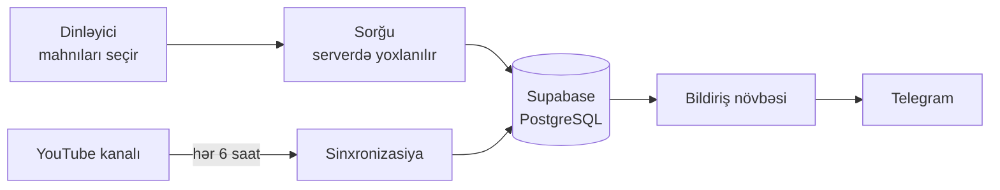

<div align="center">


<br/><br/>


# KABUS X · Fan Requests

**Növbəti Lyrics Video hansı mahnı olsun?**
Dinləyicilər mahnıları seçir, istək birbaşa sənətçinin Telegram-ına çatır.

<br/>

[](https://kabusx-fan-requests.netlify.app)


</div>

---

## Layihə haqqında

**KABUS X Fan Requests** KABUS X dinləyicilərinin hansı mahnılar üçün **Lyrics Video** istədiyini toplamaq məqsədilə qurulmuş rəsmi istək platformasıdır.

Dinləyici saytı açır, sənətçinin YouTube kanalındakı bütün videoları görür, istədiyi qədər mahnı seçir və bir kliklə göndərir. Qeydiyyat, telefon nömrəsi və ya hesab tələb olunmur. Sənətçi isə hər istəyi tam video başlığı və birbaşa YouTube linki ilə Telegram-da alır.

> Bu sayt YouTube ilə rəsmi tərəfdaşlıq iddiasında deyil.

---

## İmkanlar

| | |
|---|---|
| **Avtomatik kataloq** | Kanalın bütün videoları YouTube Data API v3 ilə çəkilir (səhifələmə ilə), orijinal tam başlıqla saxlanılır. Yeni video avtomatik görünür. |
| **Çoxlu seçim** | Bir sorğuda istənilən sayda mahnı. Seçilənlər paneli, tək-tək silmək və hamısını təmizləmək. |
| **Ağıllı axtarış** | Böyük-kiçik hərf fərqi yoxdur. `e`, `i`, `o`, `u`, `s`, `c`, `g` ilə yazanda `ə`, `ı`, `ö`, `ü`, `ş`, `ç`, `ğ` də tapılır. |
| **Etibarlı bildiriş** | Sorğu əvvəlcə bazaya yazılır, sonra Telegram-a göndərilir. Uğursuz olarsa eksponensial gecikmə ilə təkrar cəhd edilir. Sorğu heç vaxt itmir. |
| **Dublikatdan qorunma** | İdempotentlik açarı ilə eyni sorğu iki dəfə qeydə alınmır. |
| **Məxfilik** | Sənətçinin şəxsi məlumatı saytda yoxdur. Bütün açarlar yalnız serverdədir. |
| **Mobil uyğun** | Telefon, planşet və kompüterdə işləyir. |

---

## Necə işləyir



1. Hər 6 saatdan bir planlı funksiya YouTube kanalının bütün videolarını bazaya yeniləyir. Silinmiş və ya gizli videolar təklif olunmur.
2. Dinləyici `/songs` səhifəsində mahnıları seçib sorğunu göndərir.
3. Server videoların mövcudluğunu yoxlayır, sorğunu `KX-10001` kimi nömrə ilə saxlayır.
4. Hər dəqiqə işləyən planlı funksiya növbədəki bildirişləri Telegram-a göndərir.

---

## Texnologiyalar

- **Frontend:** Next.js 14 (App Router), React 18, TypeScript, Tailwind CSS
- **Backend:** Next.js API marşrutları, Zod ilə doğrulama
- **Verilənlər bazası:** Supabase PostgreSQL, indekslər, xarici açarlar, Row Level Security
- **İnteqrasiyalar:** YouTube Data API v3, Telegram Bot API
- **Yayım:** Netlify (Next.js runtime və planlı funksiyalar)

---

## Qovluq quruluşu

```
kabusx-fan-requests/
├── app/
│   ├── api/
│   │   ├── videos/            # kataloq
│   │   ├── requests/          # sorğu qəbulu
│   │   └── cron/              # sinxronizasiya və bildiriş
│   ├── songs/                 # mahnı seçimi
│   ├── how-it-works/  about/  privacy/  request/success/
├── components/                # SongPicker, Header, Footer
├── lib/                       # supabase, youtube, telegram
├── netlify/functions/         # planlı funksiyalar
├── supabase/migrations/       # verilənlər bazası sxemi
└── public/                    # şəkillər
```

---

## Quraşdırma

### 1. Verilənlər bazası

Supabase layihəsi yaradın, **SQL Editor**-də `supabase/migrations/0001_init.sql` faylını işlədin.

### 2. Mühit dəyişənləri

Netlify-da **Environment variables** bölməsinə əlavə edin. Gizli açarları heç vaxt repoya yazmayın.

| Dəyişən | Təyinatı |
|---|---|
| `NEXT_PUBLIC_SUPABASE_URL` | Supabase layihə ünvanı |
| `NEXT_PUBLIC_SUPABASE_ANON_KEY` | Publishable açar |
| `SUPABASE_SERVICE_ROLE_KEY` | Secret açar (yalnız server) |
| `YOUTUBE_API_KEY` | YouTube Data API açarı |
| `YOUTUBE_CHANNEL_HANDLE` | Kanal adı (`kabusxofficial`) |
| `TELEGRAM_BOT_TOKEN` | BotFather tokeni |
| `TELEGRAM_CHAT_ID` | Bildirişin gedəcəyi söhbət |
| `CRON_SECRET` | Planlı funksiyaların gizli açarı |

### 3. Netlify

Repo kök qovluğunda `kabusx-fan-requests` alt qovluğu olduğu üçün `netlify.toml` faylı bunu göstərir. **Publish directory** ayarını Netlify panelində boş saxlayın.

### 4. İlk sinxronizasiya

Deploy bitdikdən sonra kataloq 6 saat ərzində avtomatik dolur. Dərhal doldurmaq üçün `cron-sync` funksiyasını Netlify-da əl ilə işə salın.

---

## Yerli işə salma (istəyə bağlı)

```bash
cd kabusx-fan-requests
npm install
cp .env.example .env.local
npm run dev
```

---

## Dizayn sistemi

Rənglər sənətçinin profil şəkli və banerindən çıxarılıb.

| Token | Rəng | İstifadə |
|---|---|---|
| `--color-primary` | `#1A1210` | Mətn, başlıqlar |
| `--color-secondary` | `#6B3A22` | Hover, ikinci dərəcəli |
| `--color-accent` | `#B5521A` | Düymələr, seçilmiş kartlar |
| `--color-background` | `#FBF8F4` | Səhifə fonu |
| `--color-border` | `#E8DED4` | Kənarlıqlar |

---

## Yol xəritəsi

- [x] İctimai səhifələr (Azərbaycan dilində)
- [x] YouTube sinxronizasiyası və mahnı kataloqu
- [x] Çoxlu seçim və sorğu göndərmə
- [x] Telegram bildirişləri və təkrar cəhd mexanizmi
- [ ] Admin panel (sorğular, statuslar, qeydlər, telefonda tam işləyən)
- [ ] Göndərmə limiti və bot qorunması (CAPTCHA)
- [ ] E-poçt ehtiyat kanalı
- [ ] WhatsApp Business ehtiyat kanalı (rəsmi Meta API)
- [ ] Brend ayarları və statistika

---

## Təhlükəsizlik

- Gizli açarlar yalnız serverdə və Netlify mühit dəyişənlərindədir.
- Verilənlər bazasında Row Level Security aktivdir. İctimai istifadəçi yalnız mövcud videoları oxuya bilir.
- Planlı marşrutlar `CRON_SECRET` ilə qorunur.
- Bütün giriş məlumatları serverdə Zod ilə yoxlanılır.

---

<div align="center">

**KABUS X** · Official Fan Requests

Bu platforma KABUS X dinləyicilərinin istəklərini toplamaq üçün yaradılıb.

</div>
